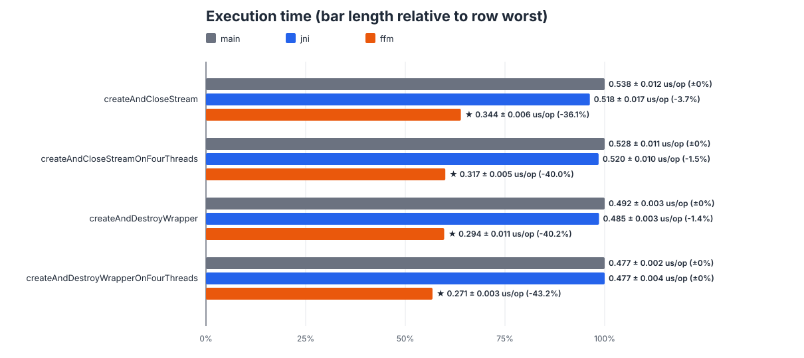
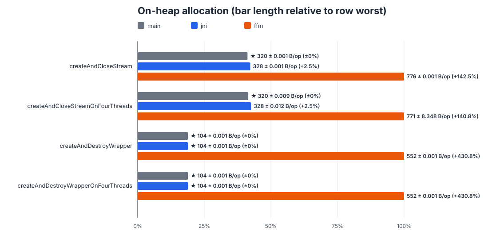
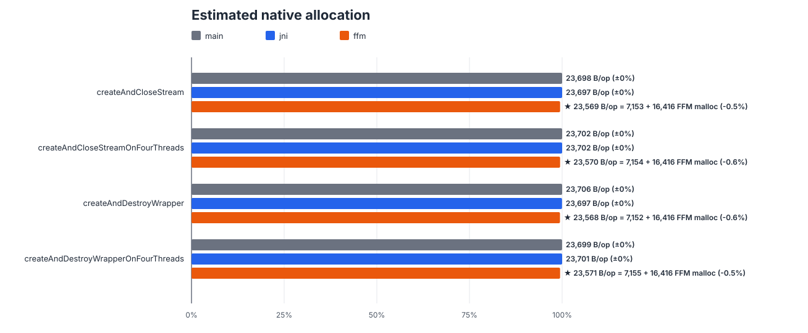

# DecoderLifecycleBenchmark — jdk-25-0-5

- `main`: 1.24.0-MAIN-0a0ac32db6 (commit 0a0ac32db68a9c2630a53f866c5eab280f1e427b)
- `jni` / `ffm`: 1.24.0-FFM-504f982a60 (commit 504f982a6043e8b91525880cea886ebcae530e69) (`-Dbrotli4j.backend=jni` / `ffm`)
- Java: OpenJDK Runtime Environment Temurin-25.0.5+8 (build 25.0.5+8-LTS); host: Linux 6.8.0-138-generic x86_64, Intel(R) Core(TM) i5-8500 CPU @ 3.00GHz, 16 GB
- Run: `20261115T083348-121950-28126`, mode ALL, extra JMH arguments: `none`

Bars are relative to the worst result of their row. Labels show the value and the change versus `main`; negative is better. ★ marks the best result of a row.

Native allocation is estimated from async-profiler's `nativemem` samples during the measurement iterations. The profiler doesn't see `ffm`'s own `malloc` downcall: FFM calls libc's `malloc` directly, past the profiler's hook. Its size is exact (the out-parameter cells plus the input buffer per wrapper), so `ffm` values are the measured value plus that count, labelled `measured + FFM malloc`.

## Execution time

`faster` / `slower`: the difference exceeds both JMH error margins (99.9%); otherwise `same`.

| Case | main | jni | ffm | ffm vs jni | ffm vs main |
|---|---|---|---|---|---|
| createAndCloseStream | 0.538 ± 0.012 us/op | 0.518 ± 0.017 us/op | 0.344 ± 0.006 us/op | faster (-33.6%) | faster (-36.1%) |
| createAndCloseStreamOnFourThreads | 0.528 ± 0.011 us/op | 0.520 ± 0.010 us/op | 0.317 ± 0.005 us/op | faster (-39.0%) | faster (-40.0%) |
| createAndDestroyWrapper | 0.492 ± 0.003 us/op | 0.485 ± 0.003 us/op | 0.294 ± 0.011 us/op | faster (-39.4%) | faster (-40.2%) |
| createAndDestroyWrapperOnFourThreads | 0.477 ± 0.002 us/op | 0.477 ± 0.004 us/op | 0.271 ± 0.003 us/op | faster (-43.2%) | faster (-43.2%) |
