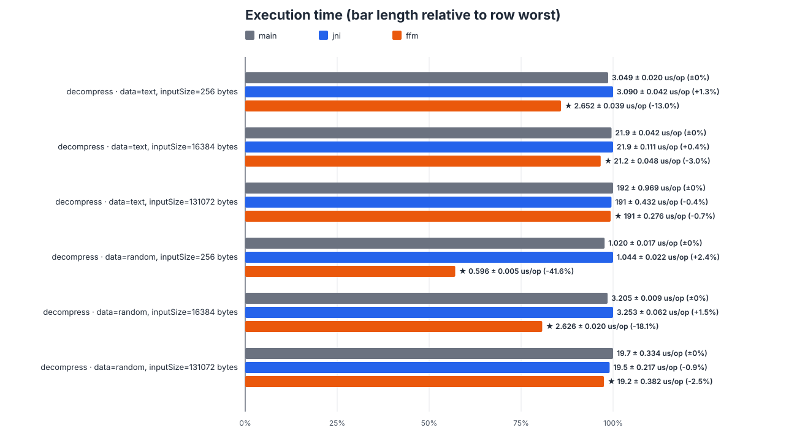
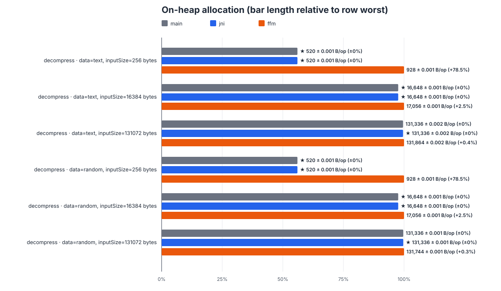
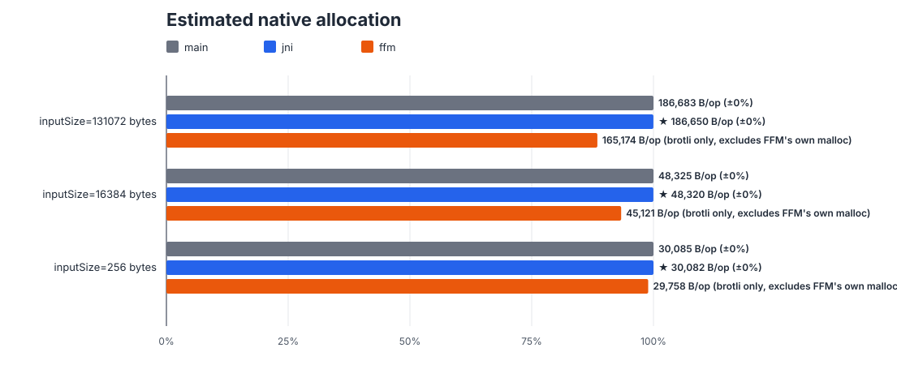

# DecoderOneShotBenchmark — jdk-25-0-5

- `main`: 1.24.0-MAIN-0a0ac32db6 (commit 0a0ac32db68a9c2630a53f866c5eab280f1e427b)
- `jni` / `ffm`: 1.24.0-FFM-504f982a60 (commit 504f982a6043e8b91525880cea886ebcae530e69) (`-Dbrotli4j.backend=jni` / `ffm`)
- Java: OpenJDK Runtime Environment Temurin-25.0.5+8 (build 25.0.5+8-LTS); host: Linux 6.8.0-138-generic x86_64, Intel(R) Core(TM) i5-8500 CPU @ 3.00GHz, 16 GB
- Run: `20261115T104216-143346-27185`, mode ALL, extra JMH arguments: `none`

Bars are relative to the worst result of their row. Labels show the value and the change versus `main`; negative is better. ★ marks the best result of a row.

Native allocation is estimated from async-profiler's `nativemem` samples during the measurement iterations. It doesn't see `ffm`'s own `malloc` downcall (32 bytes plus the input buffer per wrapper): FFM calls libc's `malloc` directly, past the profiler's hook. So `ffm` values cover brotli's allocations only, and lower `ffm` values don't mean FFM allocates less.

## Execution time

`faster` / `slower`: the difference exceeds both JMH error margins (99.9%); otherwise `same`.

| Case | main | jni | ffm | ffm vs jni | ffm vs main |
|---|---|---|---|---|---|
| decompress · data=text, inputSize=256 bytes | 3.049 ± 0.020 us/op | 3.090 ± 0.042 us/op | 2.652 ± 0.039 us/op | faster (-14.2%) | faster (-13.0%) |
| decompress · data=text, inputSize=16384 bytes | 21.9 ± 0.042 us/op | 21.9 ± 0.111 us/op | 21.2 ± 0.048 us/op | faster (-3.4%) | faster (-3.0%) |
| decompress · data=text, inputSize=131072 bytes | 192 ± 0.969 us/op | 191 ± 0.432 us/op | 191 ± 0.276 us/op | same (-0.2%) | faster (-0.7%) |
| decompress · data=random, inputSize=256 bytes | 1.020 ± 0.017 us/op | 1.044 ± 0.022 us/op | 0.596 ± 0.005 us/op | faster (-42.9%) | faster (-41.6%) |
| decompress · data=random, inputSize=16384 bytes | 3.205 ± 0.009 us/op | 3.253 ± 0.062 us/op | 2.626 ± 0.020 us/op | faster (-19.3%) | faster (-18.1%) |
| decompress · data=random, inputSize=131072 bytes | 19.7 ± 0.334 us/op | 19.5 ± 0.217 us/op | 19.2 ± 0.382 us/op | same (-1.6%) | same (-2.5%) |
