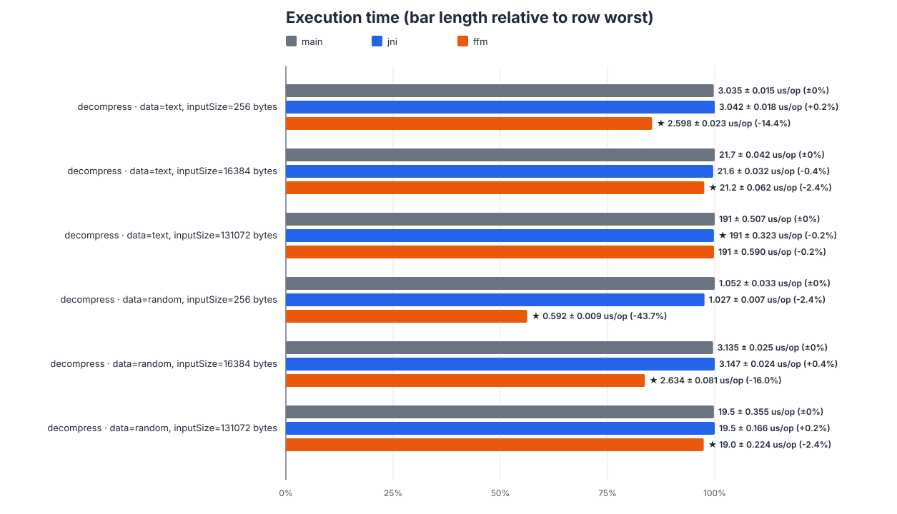
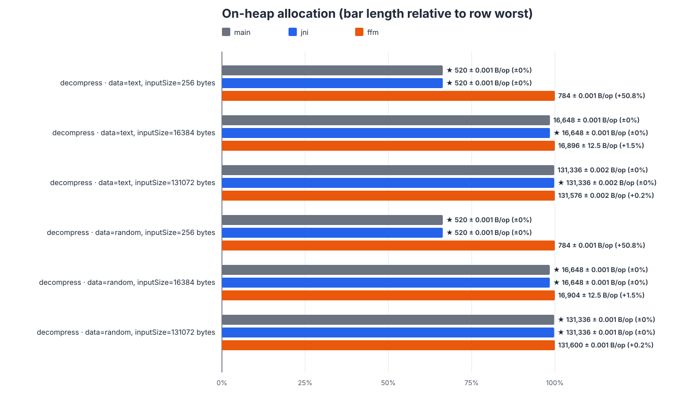
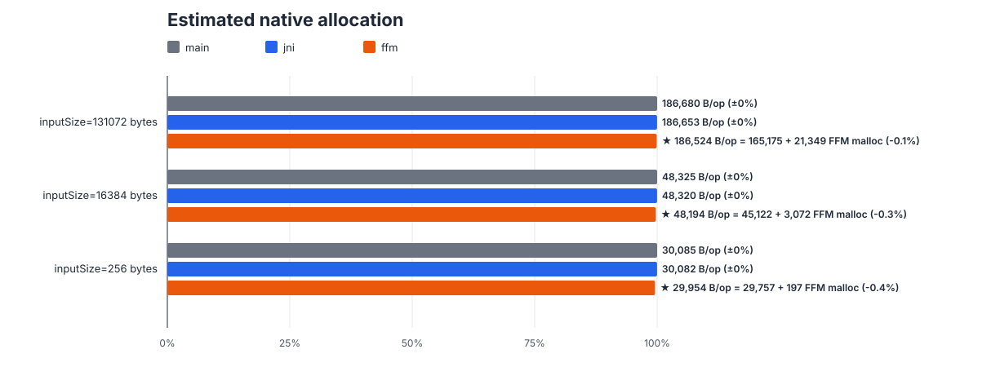

# DecoderOneShotBenchmark — jdk-25-0-5

- `main`: 1.24.0-MAIN-0a0ac32db6 (commit 0a0ac32db68a9c2630a53f866c5eab280f1e427b)
- `jni` / `ffm`: 1.24.0-FFM-8da156e83e (commit 8da156e83e7045083189f9eed6833e53420a5bd7) (`-Dbrotli4j.backend=jni` / `ffm`)
- Java: OpenJDK Runtime Environment Temurin-25.0.5+8 (build 25.0.5+8-LTS); host: Linux 6.8.0-138-generic x86_64, Intel(R) Core(TM) i5-8500 CPU @ 3.00GHz, 16 GB
- Run: `20261116T091257-69616-26143`, mode ALL, extra JMH arguments: `none`

Bars are relative to the worst result of their row. Labels show the value and the change versus `main`; negative is better. ★ marks the best result of a row.

Native allocation is estimated from async-profiler's `nativemem` samples during the measurement iterations. The profiler doesn't see `ffm`'s own `malloc` downcall: FFM calls libc's `malloc` directly, past the profiler's hook. Its size is exact (the out-parameter cells plus the input buffer per wrapper), so `ffm` values are the measured value plus that count, labelled `measured + FFM malloc`.

## Execution time

`faster` / `slower`: the difference exceeds both JMH error margins (99.9%); otherwise `same`.

| Case | main | jni | ffm | ffm vs jni | ffm vs main |
|---|---|---|---|---|---|
| decompress · data=text, inputSize=256 bytes | 3.035 ± 0.015 us/op | 3.042 ± 0.018 us/op | 2.598 ± 0.023 us/op | faster (-14.6%) | faster (-14.4%) |
| decompress · data=text, inputSize=16384 bytes | 21.7 ± 0.042 us/op | 21.6 ± 0.032 us/op | 21.2 ± 0.062 us/op | faster (-2.1%) | faster (-2.4%) |
| decompress · data=text, inputSize=131072 bytes | 191 ± 0.507 us/op | 191 ± 0.323 us/op | 191 ± 0.590 us/op | same (±0%) | same (-0.2%) |
| decompress · data=random, inputSize=256 bytes | 1.052 ± 0.033 us/op | 1.027 ± 0.007 us/op | 0.592 ± 0.009 us/op | faster (-42.4%) | faster (-43.7%) |
| decompress · data=random, inputSize=16384 bytes | 3.135 ± 0.025 us/op | 3.147 ± 0.024 us/op | 2.634 ± 0.081 us/op | faster (-16.3%) | faster (-16.0%) |
| decompress · data=random, inputSize=131072 bytes | 19.5 ± 0.355 us/op | 19.5 ± 0.166 us/op | 19.0 ± 0.224 us/op | faster (-2.6%) | same (-2.4%) |
