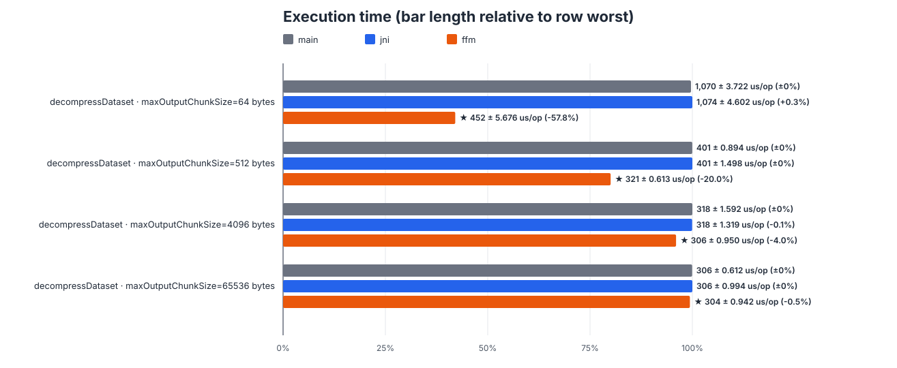
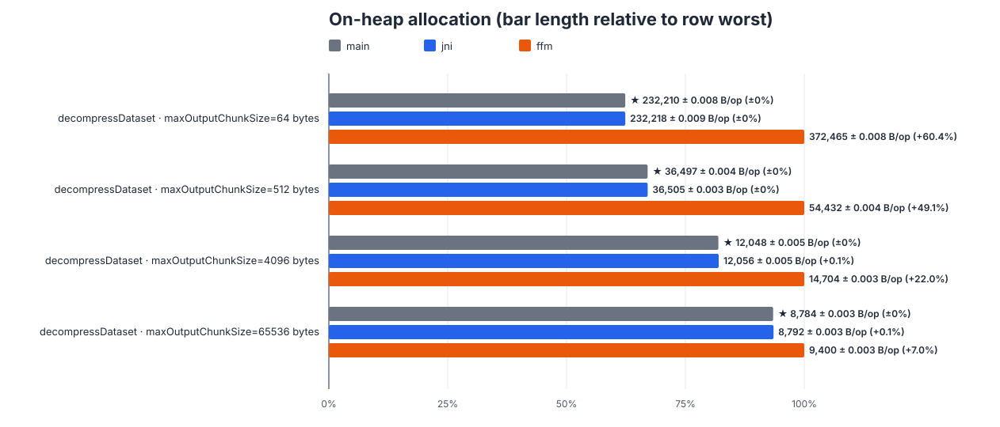
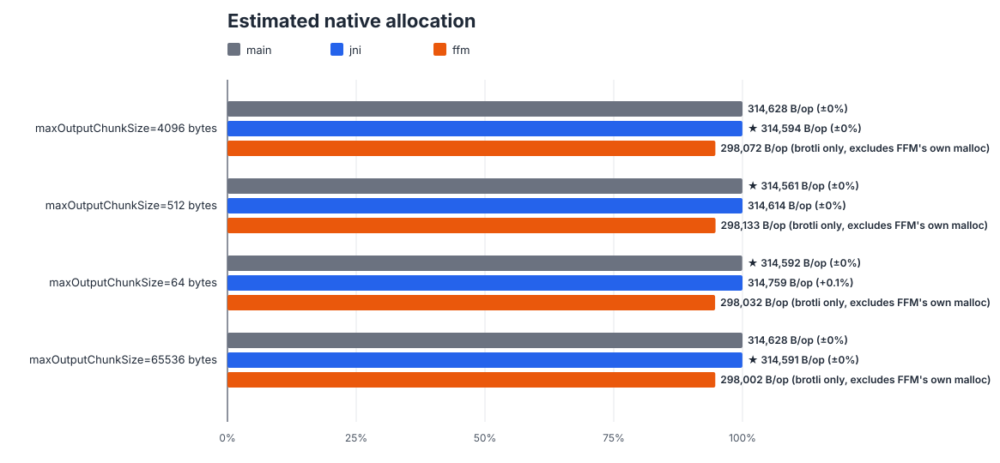

# DecoderOutputCapBenchmark — jdk-25-0-5

- `main`: 1.24.0-MAIN-0a0ac32db6 (commit 0a0ac32db68a9c2630a53f866c5eab280f1e427b)
- `jni` / `ffm`: 1.24.0-FFM-504f982a60 (commit 504f982a6043e8b91525880cea886ebcae530e69) (`-Dbrotli4j.backend=jni` / `ffm`)
- Java: OpenJDK Runtime Environment Temurin-25.0.5+8 (build 25.0.5+8-LTS); host: Linux 6.8.0-138-generic x86_64, Intel(R) Core(TM) i5-8500 CPU @ 3.00GHz, 16 GB
- Run: `20261115T144624-195657-22559`, mode ALL, extra JMH arguments: `none`

Bars are relative to the worst result of their row. Labels show the value and the change versus `main`; negative is better. ★ marks the best result of a row.

Native allocation is estimated from async-profiler's `nativemem` samples during the measurement iterations. It doesn't see `ffm`'s own `malloc` downcall (32 bytes plus the input buffer per wrapper): FFM calls libc's `malloc` directly, past the profiler's hook. So `ffm` values cover brotli's allocations only, and lower `ffm` values don't mean FFM allocates less.

## Execution time

`faster` / `slower`: the difference exceeds both JMH error margins (99.9%); otherwise `same`.

| Case | main | jni | ffm | ffm vs jni | ffm vs main |
|---|---|---|---|---|---|
| decompressDataset · maxOutputChunkSize=64 bytes | 1,070 ± 3.722 us/op | 1,074 ± 4.602 us/op | 452 ± 5.676 us/op | faster (-57.9%) | faster (-57.8%) |
| decompressDataset · maxOutputChunkSize=512 bytes | 401 ± 0.894 us/op | 401 ± 1.498 us/op | 321 ± 0.613 us/op | faster (-20.0%) | faster (-20.0%) |
| decompressDataset · maxOutputChunkSize=4096 bytes | 318 ± 1.592 us/op | 318 ± 1.319 us/op | 306 ± 0.950 us/op | faster (-3.9%) | faster (-4.0%) |
| decompressDataset · maxOutputChunkSize=65536 bytes | 306 ± 0.612 us/op | 306 ± 0.994 us/op | 304 ± 0.942 us/op | same (-0.6%) | faster (-0.5%) |
