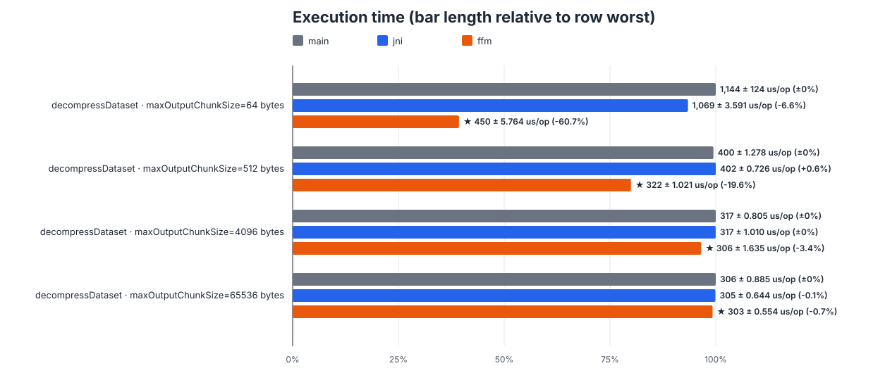
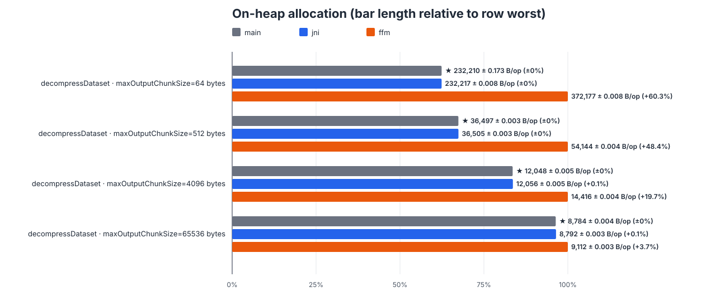
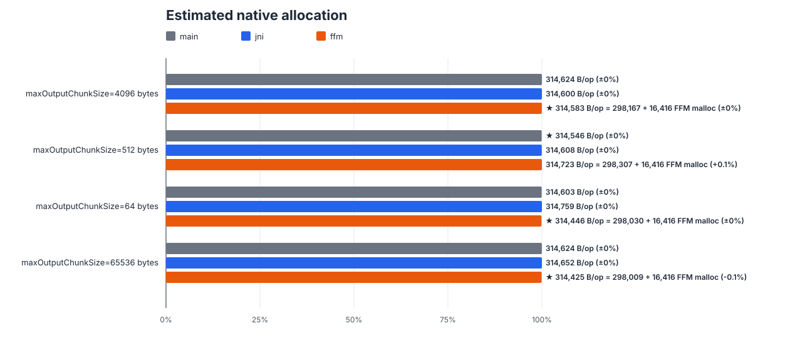

# DecoderOutputCapBenchmark — jdk-25-0-5

- `main`: 1.24.0-MAIN-0a0ac32db6 (commit 0a0ac32db68a9c2630a53f866c5eab280f1e427b)
- `jni` / `ffm`: 1.24.0-FFM-8da156e83e (commit 8da156e83e7045083189f9eed6833e53420a5bd7) (`-Dbrotli4j.backend=jni` / `ffm`)
- Java: OpenJDK Runtime Environment Temurin-25.0.5+8 (build 25.0.5+8-LTS); host: Linux 6.8.0-138-generic x86_64, Intel(R) Core(TM) i5-8500 CPU @ 3.00GHz, 16 GB
- Run: `20261116T131702-108839-13748`, mode ALL, extra JMH arguments: `none`

Bars are relative to the worst result of their row. Labels show the value and the change versus `main`; negative is better. ★ marks the best result of a row.

Native allocation is estimated from async-profiler's `nativemem` samples during the measurement iterations. The profiler doesn't see `ffm`'s own `malloc` downcall: FFM calls libc's `malloc` directly, past the profiler's hook. Its size is exact (the out-parameter cells plus the input buffer per wrapper), so `ffm` values are the measured value plus that count, labelled `measured + FFM malloc`.

## Execution time

`faster` / `slower`: the difference exceeds both JMH error margins (99.9%); otherwise `same`.

| Case | main | jni | ffm | ffm vs jni | ffm vs main |
|---|---|---|---|---|---|
| decompressDataset · maxOutputChunkSize=64 bytes | 1,144 ± 124 us/op | 1,069 ± 3.591 us/op | 450 ± 5.764 us/op | faster (-57.9%) | faster (-60.7%) |
| decompressDataset · maxOutputChunkSize=512 bytes | 400 ± 1.278 us/op | 402 ± 0.726 us/op | 322 ± 1.021 us/op | faster (-20.0%) | faster (-19.6%) |
| decompressDataset · maxOutputChunkSize=4096 bytes | 317 ± 0.805 us/op | 317 ± 1.010 us/op | 306 ± 1.635 us/op | faster (-3.4%) | faster (-3.4%) |
| decompressDataset · maxOutputChunkSize=65536 bytes | 306 ± 0.885 us/op | 305 ± 0.644 us/op | 303 ± 0.554 us/op | faster (-0.7%) | faster (-0.7%) |
