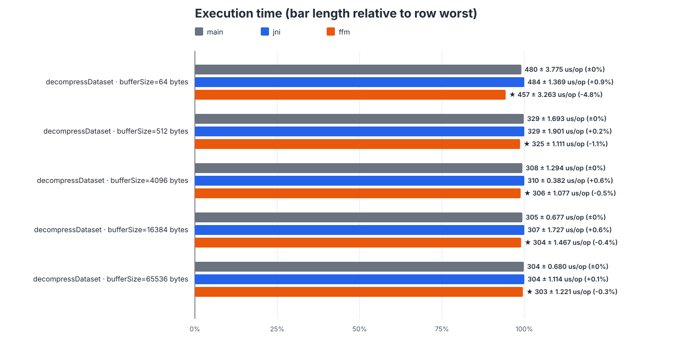
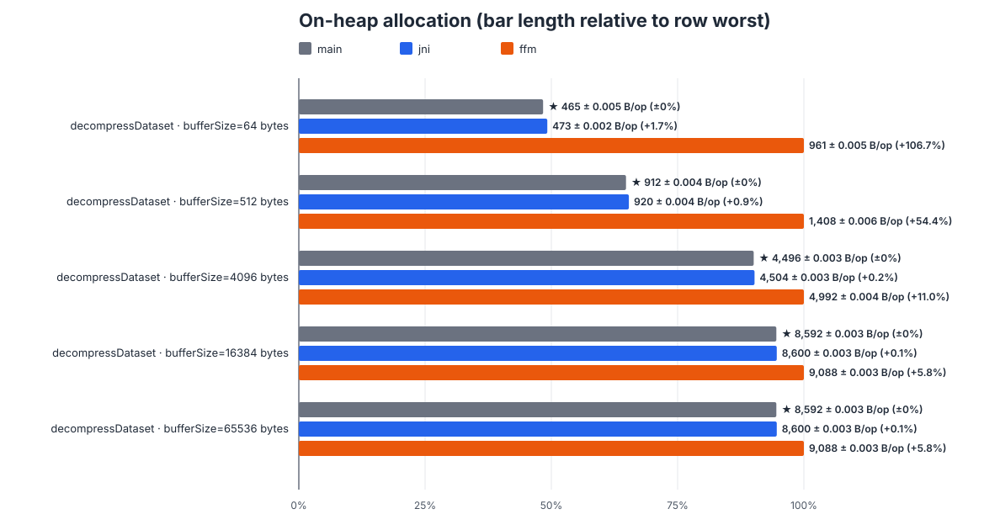
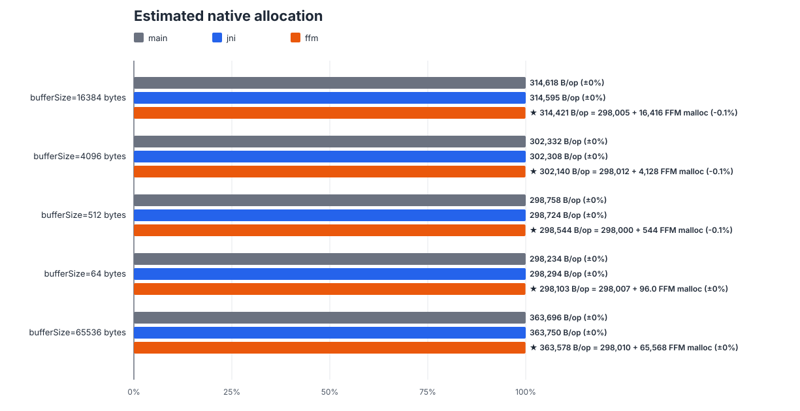

# DecoderStreamBufferSizeBenchmark — jdk-25-0-5

- `main`: 1.24.0-MAIN-0a0ac32db6 (commit 0a0ac32db68a9c2630a53f866c5eab280f1e427b)
- `jni` / `ffm`: 1.24.0-FFM-504f982a60 (commit 504f982a6043e8b91525880cea886ebcae530e69) (`-Dbrotli4j.backend=jni` / `ffm`)
- Java: OpenJDK Runtime Environment Temurin-25.0.5+8 (build 25.0.5+8-LTS); host: Linux 6.8.0-138-generic x86_64, Intel(R) Core(TM) i5-8500 CPU @ 3.00GHz, 16 GB
- Run: `20261115T134801-182786-27135`, mode ALL, extra JMH arguments: `none`

Bars are relative to the worst result of their row. Labels show the value and the change versus `main`; negative is better. ★ marks the best result of a row.

Native allocation is estimated from async-profiler's `nativemem` samples during the measurement iterations. It doesn't see `ffm`'s own `malloc` downcall (32 bytes plus the input buffer per wrapper): FFM calls libc's `malloc` directly, past the profiler's hook. So `ffm` values cover brotli's allocations only, and lower `ffm` values don't mean FFM allocates less.

## Execution time

`faster` / `slower`: the difference exceeds both JMH error margins (99.9%); otherwise `same`.

| Case | main | jni | ffm | ffm vs jni | ffm vs main |
|---|---|---|---|---|---|
| decompressDataset · bufferSize=64 bytes | 480 ± 3.775 us/op | 484 ± 1.369 us/op | 457 ± 3.263 us/op | faster (-5.6%) | faster (-4.8%) |
| decompressDataset · bufferSize=512 bytes | 329 ± 1.693 us/op | 329 ± 1.901 us/op | 325 ± 1.111 us/op | faster (-1.3%) | faster (-1.1%) |
| decompressDataset · bufferSize=4096 bytes | 308 ± 1.294 us/op | 310 ± 0.382 us/op | 306 ± 1.077 us/op | faster (-1.1%) | same (-0.5%) |
| decompressDataset · bufferSize=16384 bytes | 305 ± 0.677 us/op | 307 ± 1.727 us/op | 304 ± 1.467 us/op | same (-1.0%) | same (-0.4%) |
| decompressDataset · bufferSize=65536 bytes | 304 ± 0.680 us/op | 304 ± 1.114 us/op | 303 ± 1.221 us/op | same (-0.4%) | same (-0.3%) |
