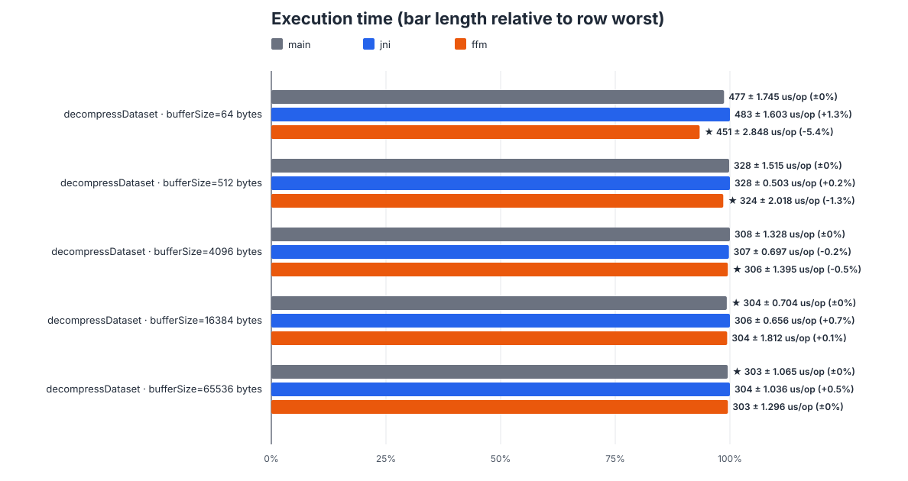
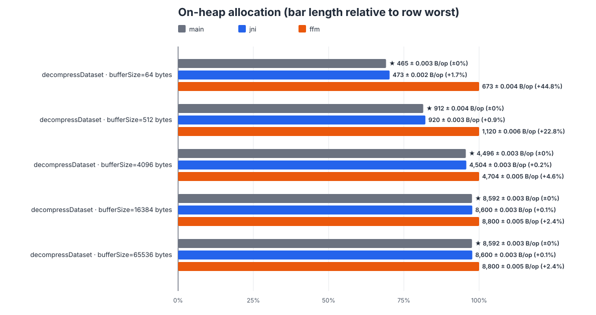
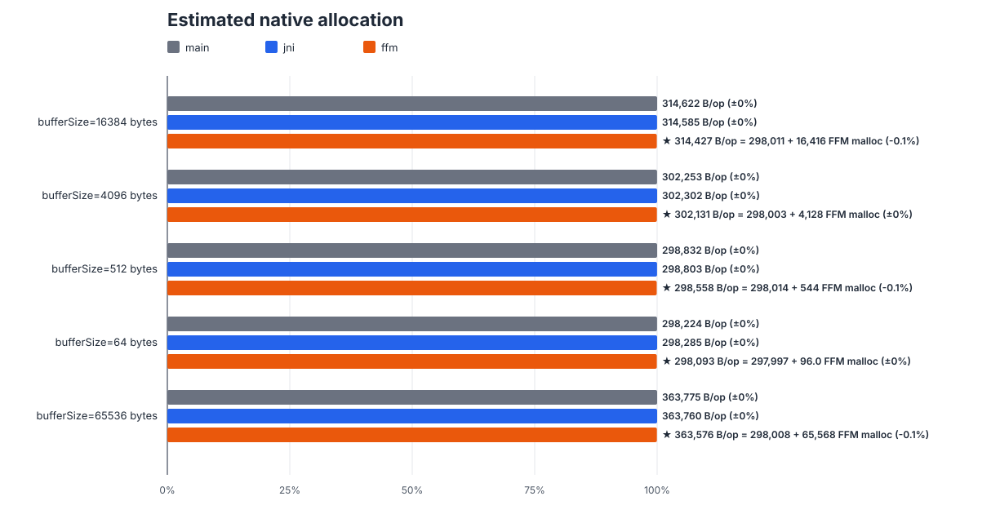

# DecoderStreamBufferSizeBenchmark — jdk-25-0-5

- `main`: 1.24.0-MAIN-0a0ac32db6 (commit 0a0ac32db68a9c2630a53f866c5eab280f1e427b)
- `jni` / `ffm`: 1.24.0-FFM-8da156e83e (commit 8da156e83e7045083189f9eed6833e53420a5bd7) (`-Dbrotli4j.backend=jni` / `ffm`)
- Java: OpenJDK Runtime Environment Temurin-25.0.5+8 (build 25.0.5+8-LTS); host: Linux 6.8.0-138-generic x86_64, Intel(R) Core(TM) i5-8500 CPU @ 3.00GHz, 16 GB
- Run: `20261116T121840-98094-9901`, mode ALL, extra JMH arguments: `none`

Bars are relative to the worst result of their row. Labels show the value and the change versus `main`; negative is better. ★ marks the best result of a row.

Native allocation is estimated from async-profiler's `nativemem` samples during the measurement iterations. The profiler doesn't see `ffm`'s own `malloc` downcall: FFM calls libc's `malloc` directly, past the profiler's hook. Its size is exact (the out-parameter cells plus the input buffer per wrapper), so `ffm` values are the measured value plus that count, labelled `measured + FFM malloc`.

## Execution time

`faster` / `slower`: the difference exceeds both JMH error margins (99.9%); otherwise `same`.

| Case | main | jni | ffm | ffm vs jni | ffm vs main |
|---|---|---|---|---|---|
| decompressDataset · bufferSize=64 bytes | 477 ± 1.745 us/op | 483 ± 1.603 us/op | 451 ± 2.848 us/op | faster (-6.6%) | faster (-5.4%) |
| decompressDataset · bufferSize=512 bytes | 328 ± 1.515 us/op | 328 ± 0.503 us/op | 324 ± 2.018 us/op | faster (-1.5%) | faster (-1.3%) |
| decompressDataset · bufferSize=4096 bytes | 308 ± 1.328 us/op | 307 ± 0.697 us/op | 306 ± 1.395 us/op | same (-0.2%) | same (-0.5%) |
| decompressDataset · bufferSize=16384 bytes | 304 ± 0.704 us/op | 306 ± 0.656 us/op | 304 ± 1.812 us/op | same (-0.6%) | same (+0.1%) |
| decompressDataset · bufferSize=65536 bytes | 303 ± 1.065 us/op | 304 ± 1.036 us/op | 303 ± 1.296 us/op | same (-0.4%) | same (±0%) |
