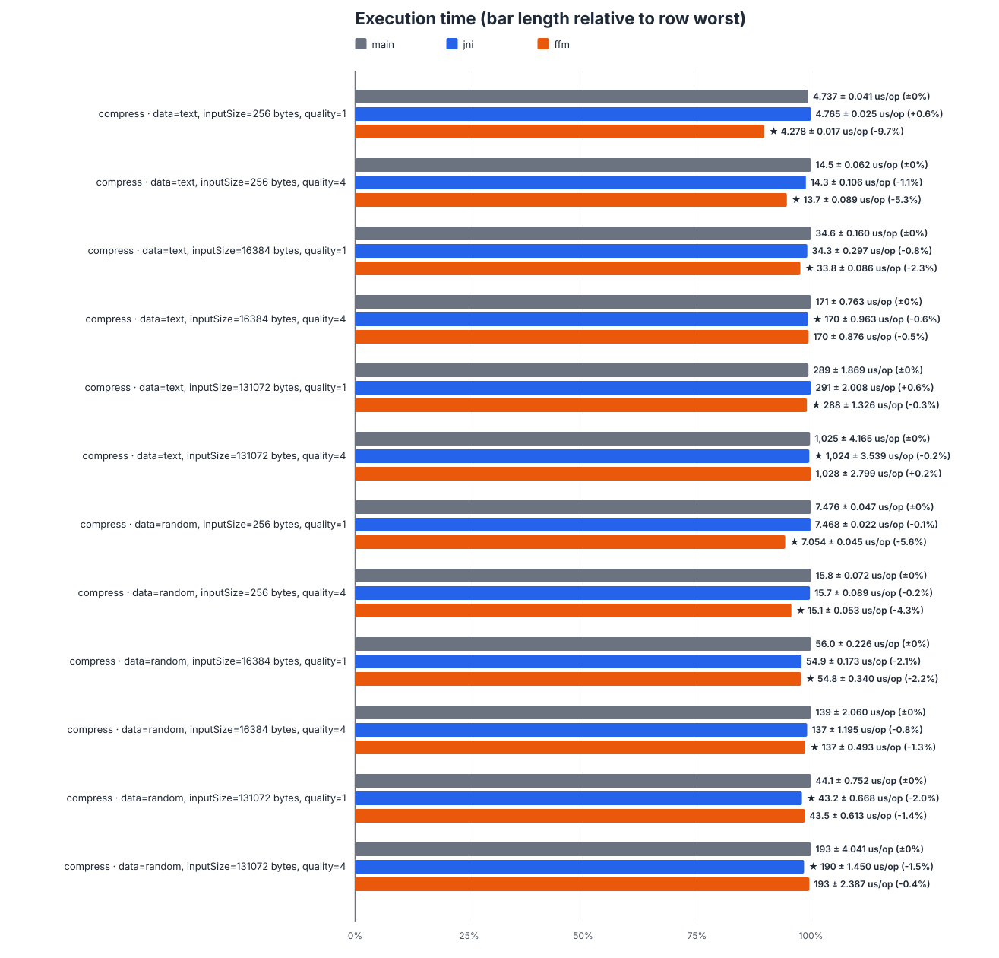
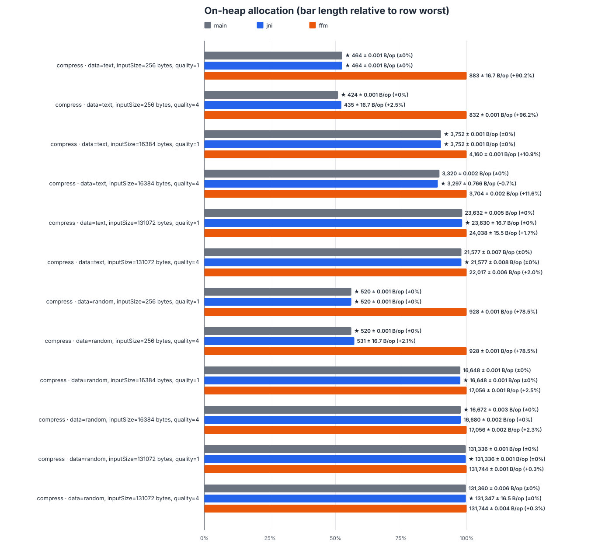
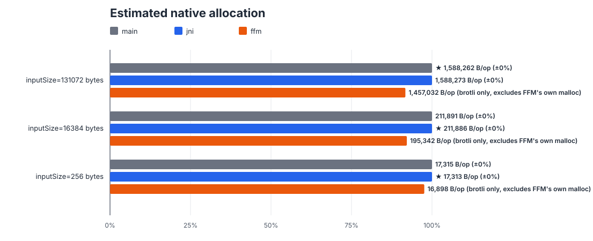

# EncoderOneShotBenchmark — jdk-25-0-5

- `main`: 1.24.0-MAIN-0a0ac32db6 (commit 0a0ac32db68a9c2630a53f866c5eab280f1e427b)
- `jni` / `ffm`: 1.24.0-FFM-504f982a60 (commit 504f982a6043e8b91525880cea886ebcae530e69) (`-Dbrotli4j.backend=jni` / `ffm`)
- Java: OpenJDK Runtime Environment Temurin-25.0.5+8 (build 25.0.5+8-LTS); host: Linux 6.8.0-138-generic x86_64, Intel(R) Core(TM) i5-8500 CPU @ 3.00GHz, 16 GB
- Run: `20261115T092031-130192-3994`, mode ALL, extra JMH arguments: `none`

Bars are relative to the worst result of their row. Labels show the value and the change versus `main`; negative is better. ★ marks the best result of a row.

Native allocation is estimated from async-profiler's `nativemem` samples during the measurement iterations. It doesn't see `ffm`'s own `malloc` downcall (32 bytes plus the input buffer per wrapper): FFM calls libc's `malloc` directly, past the profiler's hook. So `ffm` values cover brotli's allocations only, and lower `ffm` values don't mean FFM allocates less.

## Execution time

`faster` / `slower`: the difference exceeds both JMH error margins (99.9%); otherwise `same`.

| Case | main | jni | ffm | ffm vs jni | ffm vs main |
|---|---|---|---|---|---|
| compress · data=text, inputSize=256 bytes, quality=1 | 4.737 ± 0.041 us/op | 4.765 ± 0.025 us/op | 4.278 ± 0.017 us/op | faster (-10.2%) | faster (-9.7%) |
| compress · data=text, inputSize=256 bytes, quality=4 | 14.5 ± 0.062 us/op | 14.3 ± 0.106 us/op | 13.7 ± 0.089 us/op | faster (-4.2%) | faster (-5.3%) |
| compress · data=text, inputSize=16384 bytes, quality=1 | 34.6 ± 0.160 us/op | 34.3 ± 0.297 us/op | 33.8 ± 0.086 us/op | faster (-1.5%) | faster (-2.3%) |
| compress · data=text, inputSize=16384 bytes, quality=4 | 171 ± 0.763 us/op | 170 ± 0.963 us/op | 170 ± 0.876 us/op | same (+0.1%) | same (-0.5%) |
| compress · data=text, inputSize=131072 bytes, quality=1 | 289 ± 1.869 us/op | 291 ± 2.008 us/op | 288 ± 1.326 us/op | same (-0.9%) | same (-0.3%) |
| compress · data=text, inputSize=131072 bytes, quality=4 | 1,025 ± 4.165 us/op | 1,024 ± 3.539 us/op | 1,028 ± 2.799 us/op | same (+0.4%) | same (+0.2%) |
| compress · data=random, inputSize=256 bytes, quality=1 | 7.476 ± 0.047 us/op | 7.468 ± 0.022 us/op | 7.054 ± 0.045 us/op | faster (-5.5%) | faster (-5.6%) |
| compress · data=random, inputSize=256 bytes, quality=4 | 15.8 ± 0.072 us/op | 15.7 ± 0.089 us/op | 15.1 ± 0.053 us/op | faster (-4.1%) | faster (-4.3%) |
| compress · data=random, inputSize=16384 bytes, quality=1 | 56.0 ± 0.226 us/op | 54.9 ± 0.173 us/op | 54.8 ± 0.340 us/op | same (-0.1%) | faster (-2.2%) |
| compress · data=random, inputSize=16384 bytes, quality=4 | 139 ± 2.060 us/op | 137 ± 1.195 us/op | 137 ± 0.493 us/op | same (-0.4%) | same (-1.3%) |
| compress · data=random, inputSize=131072 bytes, quality=1 | 44.1 ± 0.752 us/op | 43.2 ± 0.668 us/op | 43.5 ± 0.613 us/op | same (+0.6%) | same (-1.4%) |
| compress · data=random, inputSize=131072 bytes, quality=4 | 193 ± 4.041 us/op | 190 ± 1.450 us/op | 193 ± 2.387 us/op | same (+1.2%) | same (-0.4%) |
