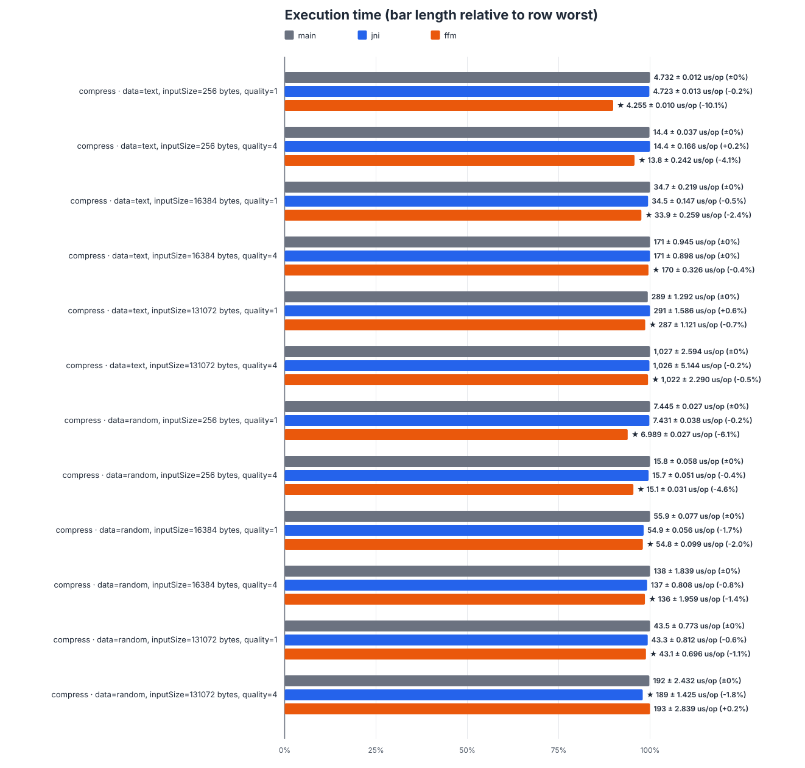
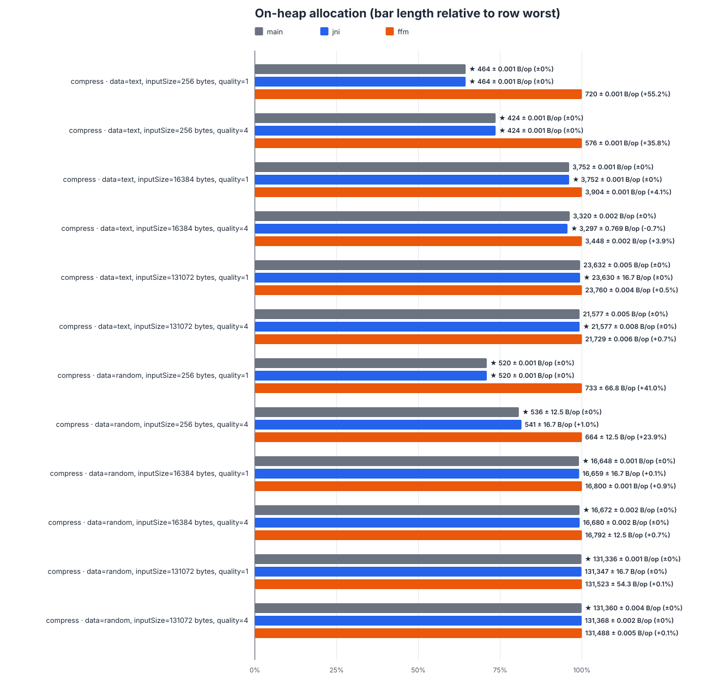
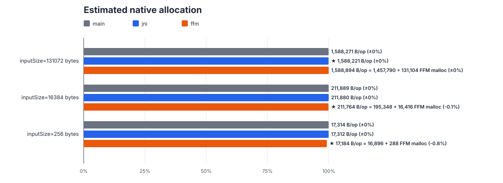

# EncoderOneShotBenchmark — jdk-25-0-5

- `main`: 1.24.0-MAIN-0a0ac32db6 (commit 0a0ac32db68a9c2630a53f866c5eab280f1e427b)
- `jni` / `ffm`: 1.24.0-FFM-8da156e83e (commit 8da156e83e7045083189f9eed6833e53420a5bd7) (`-Dbrotli4j.backend=jni` / `ffm`)
- Java: OpenJDK Runtime Environment Temurin-25.0.5+8 (build 25.0.5+8-LTS); host: Linux 6.8.0-138-generic x86_64, Intel(R) Core(TM) i5-8500 CPU @ 3.00GHz, 16 GB
- Run: `20261116T075113-58944-30705`, mode ALL, extra JMH arguments: `none`

Bars are relative to the worst result of their row. Labels show the value and the change versus `main`; negative is better. ★ marks the best result of a row.

Native allocation is estimated from async-profiler's `nativemem` samples during the measurement iterations. The profiler doesn't see `ffm`'s own `malloc` downcall: FFM calls libc's `malloc` directly, past the profiler's hook. Its size is exact (the out-parameter cells plus the input buffer per wrapper), so `ffm` values are the measured value plus that count, labelled `measured + FFM malloc`.

## Execution time

`faster` / `slower`: the difference exceeds both JMH error margins (99.9%); otherwise `same`.

| Case | main | jni | ffm | ffm vs jni | ffm vs main |
|---|---|---|---|---|---|
| compress · data=text, inputSize=256 bytes, quality=1 | 4.732 ± 0.012 us/op | 4.723 ± 0.013 us/op | 4.255 ± 0.010 us/op | faster (-9.9%) | faster (-10.1%) |
| compress · data=text, inputSize=256 bytes, quality=4 | 14.4 ± 0.037 us/op | 14.4 ± 0.166 us/op | 13.8 ± 0.242 us/op | faster (-4.2%) | faster (-4.1%) |
| compress · data=text, inputSize=16384 bytes, quality=1 | 34.7 ± 0.219 us/op | 34.5 ± 0.147 us/op | 33.9 ± 0.259 us/op | faster (-1.8%) | faster (-2.4%) |
| compress · data=text, inputSize=16384 bytes, quality=4 | 171 ± 0.945 us/op | 171 ± 0.898 us/op | 170 ± 0.326 us/op | same (-0.4%) | same (-0.4%) |
| compress · data=text, inputSize=131072 bytes, quality=1 | 289 ± 1.292 us/op | 291 ± 1.586 us/op | 287 ± 1.121 us/op | faster (-1.3%) | same (-0.7%) |
| compress · data=text, inputSize=131072 bytes, quality=4 | 1,027 ± 2.594 us/op | 1,026 ± 5.144 us/op | 1,022 ± 2.290 us/op | same (-0.4%) | faster (-0.5%) |
| compress · data=random, inputSize=256 bytes, quality=1 | 7.445 ± 0.027 us/op | 7.431 ± 0.038 us/op | 6.989 ± 0.027 us/op | faster (-5.9%) | faster (-6.1%) |
| compress · data=random, inputSize=256 bytes, quality=4 | 15.8 ± 0.058 us/op | 15.7 ± 0.051 us/op | 15.1 ± 0.031 us/op | faster (-4.2%) | faster (-4.6%) |
| compress · data=random, inputSize=16384 bytes, quality=1 | 55.9 ± 0.077 us/op | 54.9 ± 0.056 us/op | 54.8 ± 0.099 us/op | same (-0.2%) | faster (-2.0%) |
| compress · data=random, inputSize=16384 bytes, quality=4 | 138 ± 1.839 us/op | 137 ± 0.808 us/op | 136 ± 1.959 us/op | same (-0.6%) | same (-1.4%) |
| compress · data=random, inputSize=131072 bytes, quality=1 | 43.5 ± 0.773 us/op | 43.3 ± 0.812 us/op | 43.1 ± 0.696 us/op | same (-0.5%) | same (-1.1%) |
| compress · data=random, inputSize=131072 bytes, quality=4 | 192 ± 2.432 us/op | 189 ± 1.425 us/op | 193 ± 2.839 us/op | same (+2.0%) | same (+0.2%) |
