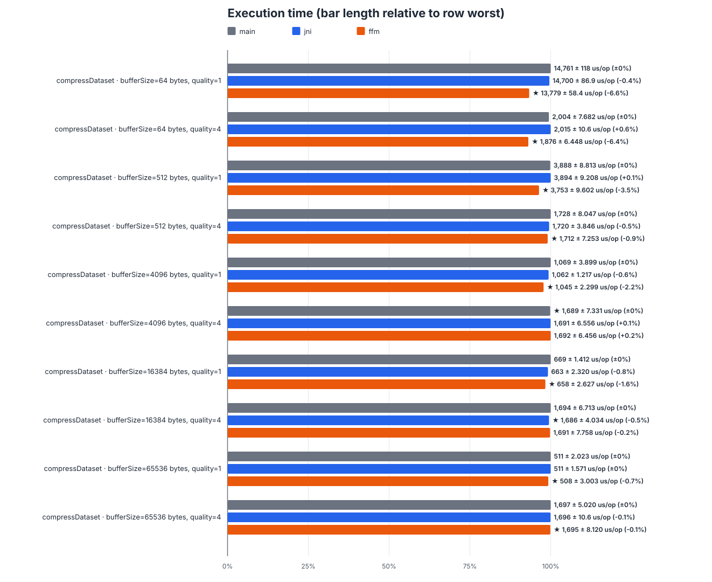
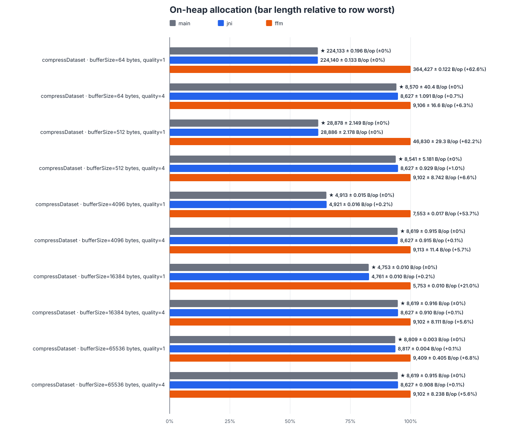
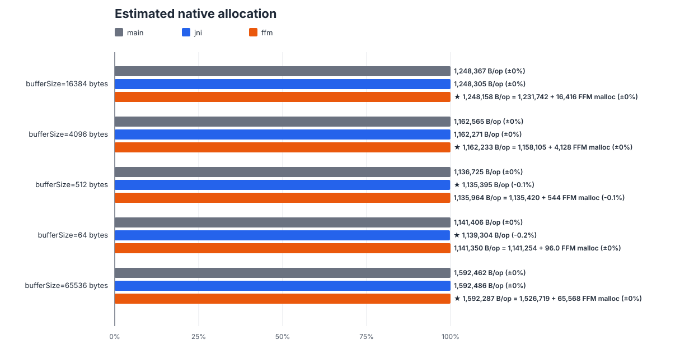

# EncoderStreamBufferSizeBenchmark — jdk-25-0-5

- `main`: 1.24.0-MAIN-0a0ac32db6 (commit 0a0ac32db68a9c2630a53f866c5eab280f1e427b)
- `jni` / `ffm`: 1.24.0-FFM-504f982a60 (commit 504f982a6043e8b91525880cea886ebcae530e69) (`-Dbrotli4j.backend=jni` / `ffm`)
- Java: OpenJDK Runtime Environment Temurin-25.0.5+8 (build 25.0.5+8-LTS); host: Linux 6.8.0-138-generic x86_64, Intel(R) Core(TM) i5-8500 CPU @ 3.00GHz, 16 GB
- Run: `20261115T113255-153985-31791`, mode ALL, extra JMH arguments: `none`

Bars are relative to the worst result of their row. Labels show the value and the change versus `main`; negative is better. ★ marks the best result of a row.

Native allocation is estimated from async-profiler's `nativemem` samples during the measurement iterations. It doesn't see `ffm`'s own `malloc` downcall (32 bytes plus the input buffer per wrapper): FFM calls libc's `malloc` directly, past the profiler's hook. So `ffm` values cover brotli's allocations only, and lower `ffm` values don't mean FFM allocates less.

## Execution time

`faster` / `slower`: the difference exceeds both JMH error margins (99.9%); otherwise `same`.

| Case | main | jni | ffm | ffm vs jni | ffm vs main |
|---|---|---|---|---|---|
| compressDataset · bufferSize=64 bytes, quality=1 | 14,761 ± 118 us/op | 14,700 ± 86.9 us/op | 13,779 ± 58.4 us/op | faster (-6.3%) | faster (-6.6%) |
| compressDataset · bufferSize=64 bytes, quality=4 | 2,004 ± 7.682 us/op | 2,015 ± 10.6 us/op | 1,876 ± 6.448 us/op | faster (-6.9%) | faster (-6.4%) |
| compressDataset · bufferSize=512 bytes, quality=1 | 3,888 ± 8.813 us/op | 3,894 ± 9.208 us/op | 3,753 ± 9.602 us/op | faster (-3.6%) | faster (-3.5%) |
| compressDataset · bufferSize=512 bytes, quality=4 | 1,728 ± 8.047 us/op | 1,720 ± 3.846 us/op | 1,712 ± 7.253 us/op | same (-0.5%) | faster (-0.9%) |
| compressDataset · bufferSize=4096 bytes, quality=1 | 1,069 ± 3.899 us/op | 1,062 ± 1.217 us/op | 1,045 ± 2.299 us/op | faster (-1.6%) | faster (-2.2%) |
| compressDataset · bufferSize=4096 bytes, quality=4 | 1,689 ± 7.331 us/op | 1,691 ± 6.556 us/op | 1,692 ± 6.456 us/op | same (±0%) | same (+0.2%) |
| compressDataset · bufferSize=16384 bytes, quality=1 | 669 ± 1.412 us/op | 663 ± 2.320 us/op | 658 ± 2.627 us/op | faster (-0.8%) | faster (-1.6%) |
| compressDataset · bufferSize=16384 bytes, quality=4 | 1,694 ± 6.713 us/op | 1,686 ± 4.034 us/op | 1,691 ± 7.758 us/op | same (+0.3%) | same (-0.2%) |
| compressDataset · bufferSize=65536 bytes, quality=1 | 511 ± 2.023 us/op | 511 ± 1.571 us/op | 508 ± 3.003 us/op | same (-0.7%) | same (-0.7%) |
| compressDataset · bufferSize=65536 bytes, quality=4 | 1,697 ± 5.020 us/op | 1,696 ± 10.6 us/op | 1,695 ± 8.120 us/op | same (-0.1%) | same (-0.1%) |
