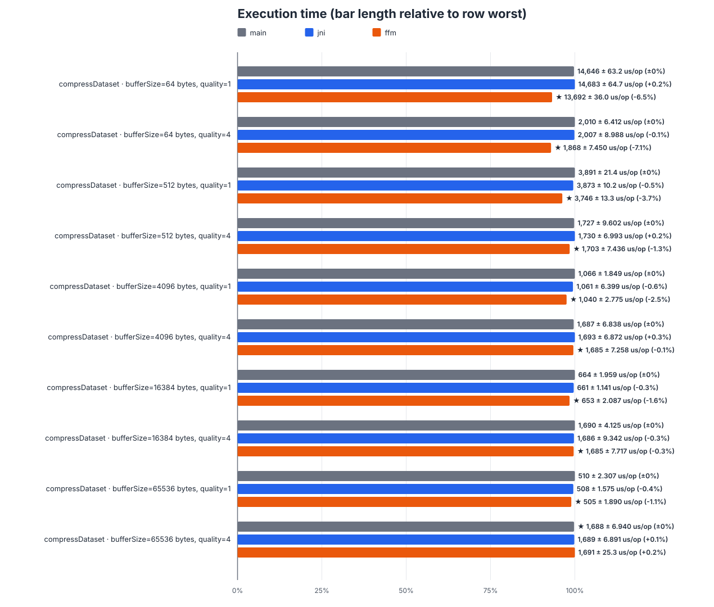
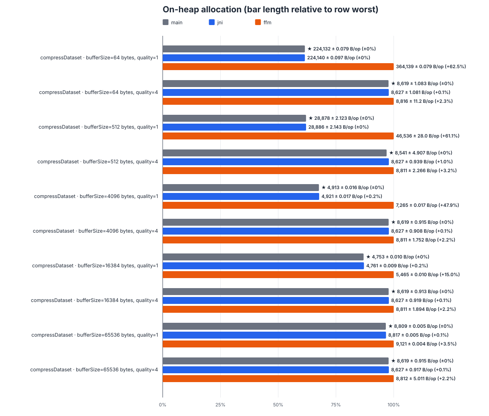
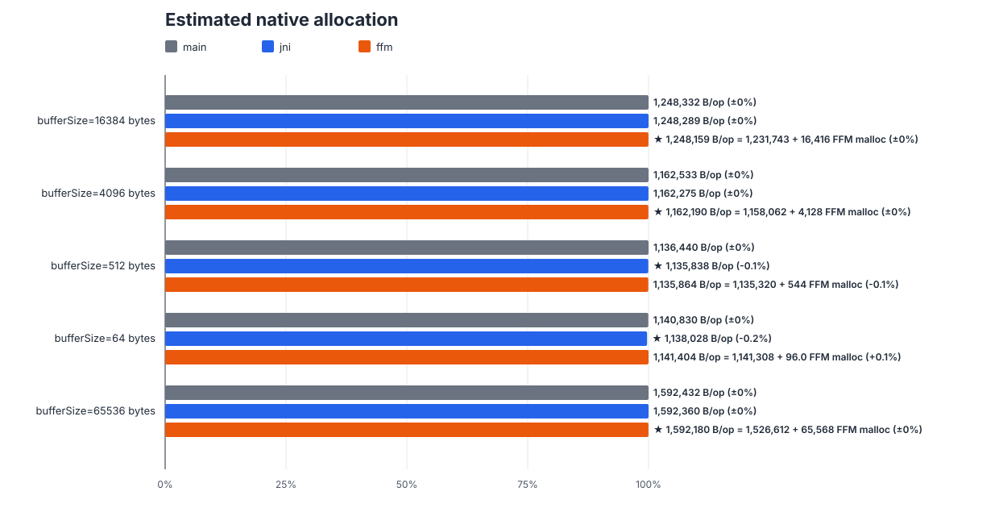

# EncoderStreamBufferSizeBenchmark — jdk-25-0-5

- `main`: 1.24.0-MAIN-0a0ac32db6 (commit 0a0ac32db68a9c2630a53f866c5eab280f1e427b)
- `jni` / `ffm`: 1.24.0-FFM-8da156e83e (commit 8da156e83e7045083189f9eed6833e53420a5bd7) (`-Dbrotli4j.backend=jni` / `ffm`)
- Java: OpenJDK Runtime Environment Temurin-25.0.5+8 (build 25.0.5+8-LTS); host: Linux 6.8.0-138-generic x86_64, Intel(R) Core(TM) i5-8500 CPU @ 3.00GHz, 16 GB
- Run: `20261116T100335-77318-16861`, mode ALL, extra JMH arguments: `none`

Bars are relative to the worst result of their row. Labels show the value and the change versus `main`; negative is better. ★ marks the best result of a row.

Native allocation is estimated from async-profiler's `nativemem` samples during the measurement iterations. The profiler doesn't see `ffm`'s own `malloc` downcall: FFM calls libc's `malloc` directly, past the profiler's hook. Its size is exact (the out-parameter cells plus the input buffer per wrapper), so `ffm` values are the measured value plus that count, labelled `measured + FFM malloc`.

## Execution time

`faster` / `slower`: the difference exceeds both JMH error margins (99.9%); otherwise `same`.

| Case | main | jni | ffm | ffm vs jni | ffm vs main |
|---|---|---|---|---|---|
| compressDataset · bufferSize=64 bytes, quality=1 | 14,646 ± 63.2 us/op | 14,683 ± 64.7 us/op | 13,692 ± 36.0 us/op | faster (-6.7%) | faster (-6.5%) |
| compressDataset · bufferSize=64 bytes, quality=4 | 2,010 ± 6.412 us/op | 2,007 ± 8.988 us/op | 1,868 ± 7.450 us/op | faster (-6.9%) | faster (-7.1%) |
| compressDataset · bufferSize=512 bytes, quality=1 | 3,891 ± 21.4 us/op | 3,873 ± 10.2 us/op | 3,746 ± 13.3 us/op | faster (-3.3%) | faster (-3.7%) |
| compressDataset · bufferSize=512 bytes, quality=4 | 1,727 ± 9.602 us/op | 1,730 ± 6.993 us/op | 1,703 ± 7.436 us/op | faster (-1.5%) | faster (-1.3%) |
| compressDataset · bufferSize=4096 bytes, quality=1 | 1,066 ± 1.849 us/op | 1,061 ± 6.399 us/op | 1,040 ± 2.775 us/op | faster (-1.9%) | faster (-2.5%) |
| compressDataset · bufferSize=4096 bytes, quality=4 | 1,687 ± 6.838 us/op | 1,693 ± 6.872 us/op | 1,685 ± 7.258 us/op | same (-0.4%) | same (-0.1%) |
| compressDataset · bufferSize=16384 bytes, quality=1 | 664 ± 1.959 us/op | 661 ± 1.141 us/op | 653 ± 2.087 us/op | faster (-1.2%) | faster (-1.6%) |
| compressDataset · bufferSize=16384 bytes, quality=4 | 1,690 ± 4.125 us/op | 1,686 ± 9.342 us/op | 1,685 ± 7.717 us/op | same (-0.1%) | same (-0.3%) |
| compressDataset · bufferSize=65536 bytes, quality=1 | 510 ± 2.307 us/op | 508 ± 1.575 us/op | 505 ± 1.890 us/op | same (-0.6%) | faster (-1.1%) |
| compressDataset · bufferSize=65536 bytes, quality=4 | 1,688 ± 6.940 us/op | 1,689 ± 6.891 us/op | 1,691 ± 25.3 us/op | same (+0.2%) | same (+0.2%) |
