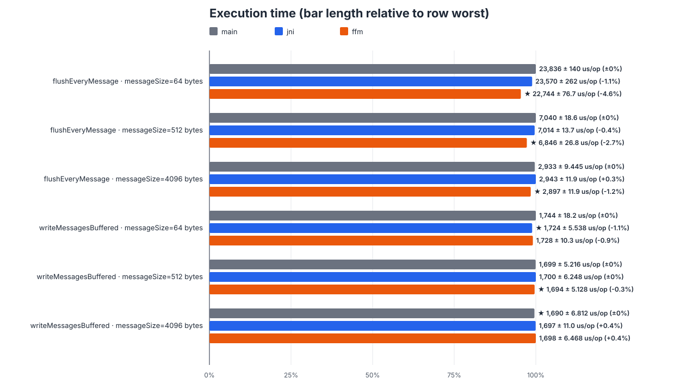
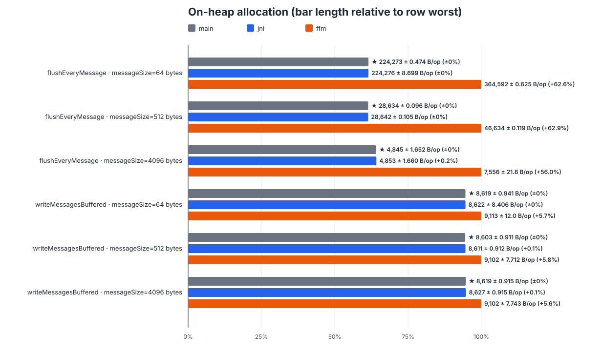
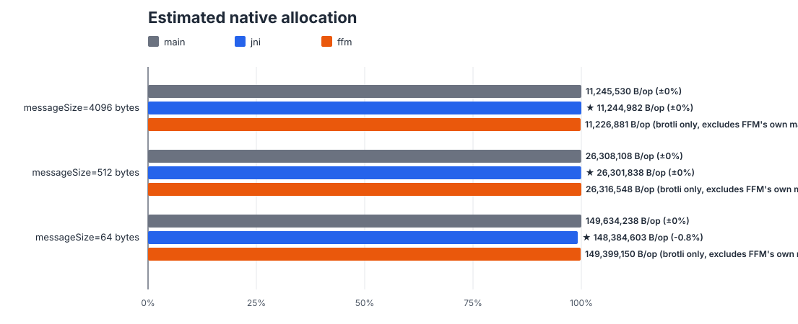

# EncoderStreamFlushBenchmark — jdk-25-0-5

- `main`: 1.24.0-MAIN-0a0ac32db6 (commit 0a0ac32db68a9c2630a53f866c5eab280f1e427b)
- `jni` / `ffm`: 1.24.0-FFM-504f982a60 (commit 504f982a6043e8b91525880cea886ebcae530e69) (`-Dbrotli4j.backend=jni` / `ffm`)
- Java: OpenJDK Runtime Environment Temurin-25.0.5+8 (build 25.0.5+8-LTS); host: Linux 6.8.0-138-generic x86_64, Intel(R) Core(TM) i5-8500 CPU @ 3.00GHz, 16 GB
- Run: `20261115T125716-171730-12002`, mode ALL, extra JMH arguments: `none`

Bars are relative to the worst result of their row. Labels show the value and the change versus `main`; negative is better. ★ marks the best result of a row.

Native allocation is estimated from async-profiler's `nativemem` samples during the measurement iterations. It doesn't see `ffm`'s own `malloc` downcall (32 bytes plus the input buffer per wrapper): FFM calls libc's `malloc` directly, past the profiler's hook. So `ffm` values cover brotli's allocations only, and lower `ffm` values don't mean FFM allocates less.

## Execution time

`faster` / `slower`: the difference exceeds both JMH error margins (99.9%); otherwise `same`.

| Case | main | jni | ffm | ffm vs jni | ffm vs main |
|---|---|---|---|---|---|
| flushEveryMessage · messageSize=64 bytes | 23,836 ± 140 us/op | 23,570 ± 262 us/op | 22,744 ± 76.7 us/op | faster (-3.5%) | faster (-4.6%) |
| flushEveryMessage · messageSize=512 bytes | 7,040 ± 18.6 us/op | 7,014 ± 13.7 us/op | 6,846 ± 26.8 us/op | faster (-2.4%) | faster (-2.7%) |
| flushEveryMessage · messageSize=4096 bytes | 2,933 ± 9.445 us/op | 2,943 ± 11.9 us/op | 2,897 ± 11.9 us/op | faster (-1.5%) | faster (-1.2%) |
| writeMessagesBuffered · messageSize=64 bytes | 1,744 ± 18.2 us/op | 1,724 ± 5.538 us/op | 1,728 ± 10.3 us/op | same (+0.2%) | same (-0.9%) |
| writeMessagesBuffered · messageSize=512 bytes | 1,699 ± 5.216 us/op | 1,700 ± 6.248 us/op | 1,694 ± 5.128 us/op | same (-0.4%) | same (-0.3%) |
| writeMessagesBuffered · messageSize=4096 bytes | 1,690 ± 6.812 us/op | 1,697 ± 11.0 us/op | 1,698 ± 6.468 us/op | same (+0.1%) | same (+0.4%) |
