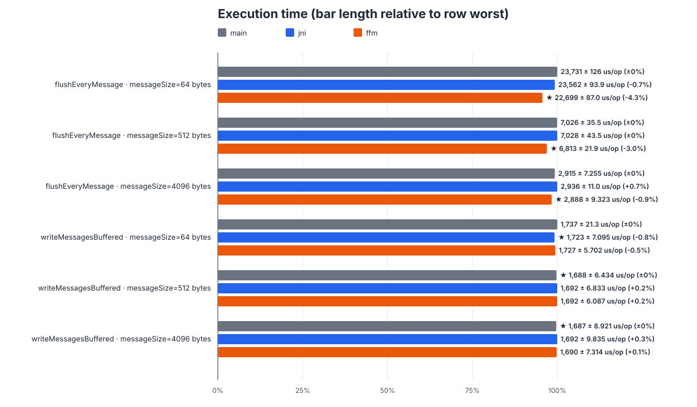
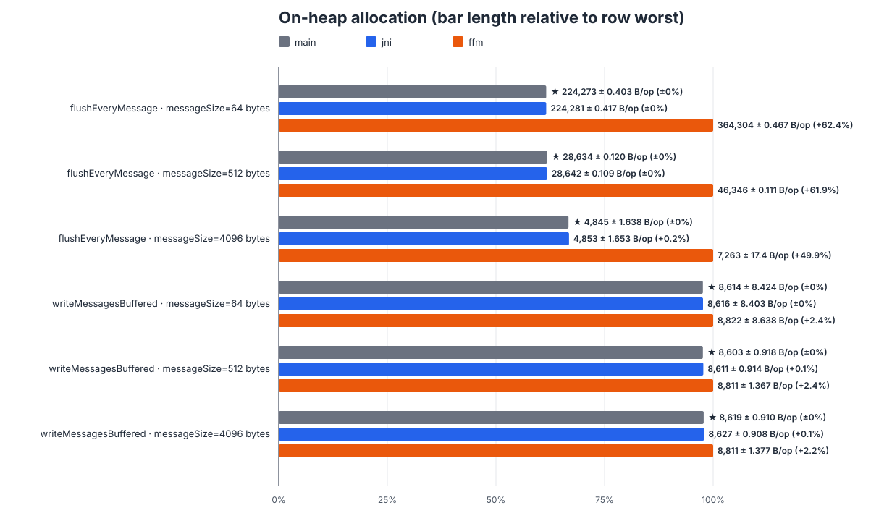
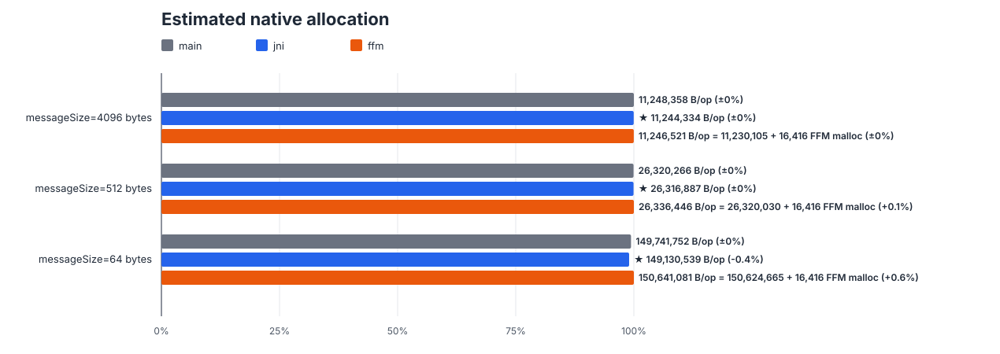

# EncoderStreamFlushBenchmark — jdk-25-0-5

- `main`: 1.24.0-MAIN-0a0ac32db6 (commit 0a0ac32db68a9c2630a53f866c5eab280f1e427b)
- `jni` / `ffm`: 1.24.0-FFM-8da156e83e (commit 8da156e83e7045083189f9eed6833e53420a5bd7) (`-Dbrotli4j.backend=jni` / `ffm`)
- Java: OpenJDK Runtime Environment Temurin-25.0.5+8 (build 25.0.5+8-LTS); host: Linux 6.8.0-138-generic x86_64, Intel(R) Core(TM) i5-8500 CPU @ 3.00GHz, 16 GB
- Run: `20261116T112755-90133-31232`, mode ALL, extra JMH arguments: `none`

Bars are relative to the worst result of their row. Labels show the value and the change versus `main`; negative is better. ★ marks the best result of a row.

Native allocation is estimated from async-profiler's `nativemem` samples during the measurement iterations. The profiler doesn't see `ffm`'s own `malloc` downcall: FFM calls libc's `malloc` directly, past the profiler's hook. Its size is exact (the out-parameter cells plus the input buffer per wrapper), so `ffm` values are the measured value plus that count, labelled `measured + FFM malloc`.

## Execution time

`faster` / `slower`: the difference exceeds both JMH error margins (99.9%); otherwise `same`.

| Case | main | jni | ffm | ffm vs jni | ffm vs main |
|---|---|---|---|---|---|
| flushEveryMessage · messageSize=64 bytes | 23,731 ± 126 us/op | 23,562 ± 93.9 us/op | 22,699 ± 87.0 us/op | faster (-3.7%) | faster (-4.3%) |
| flushEveryMessage · messageSize=512 bytes | 7,026 ± 35.5 us/op | 7,028 ± 43.5 us/op | 6,813 ± 21.9 us/op | faster (-3.1%) | faster (-3.0%) |
| flushEveryMessage · messageSize=4096 bytes | 2,915 ± 7.255 us/op | 2,936 ± 11.0 us/op | 2,888 ± 9.323 us/op | faster (-1.6%) | faster (-0.9%) |
| writeMessagesBuffered · messageSize=64 bytes | 1,737 ± 21.3 us/op | 1,723 ± 7.095 us/op | 1,727 ± 5.702 us/op | same (+0.3%) | same (-0.5%) |
| writeMessagesBuffered · messageSize=512 bytes | 1,688 ± 6.434 us/op | 1,692 ± 6.833 us/op | 1,692 ± 6.087 us/op | same (±0%) | same (+0.2%) |
| writeMessagesBuffered · messageSize=4096 bytes | 1,687 ± 8.921 us/op | 1,692 ± 9.835 us/op | 1,690 ± 7.314 us/op | same (-0.2%) | same (+0.1%) |
